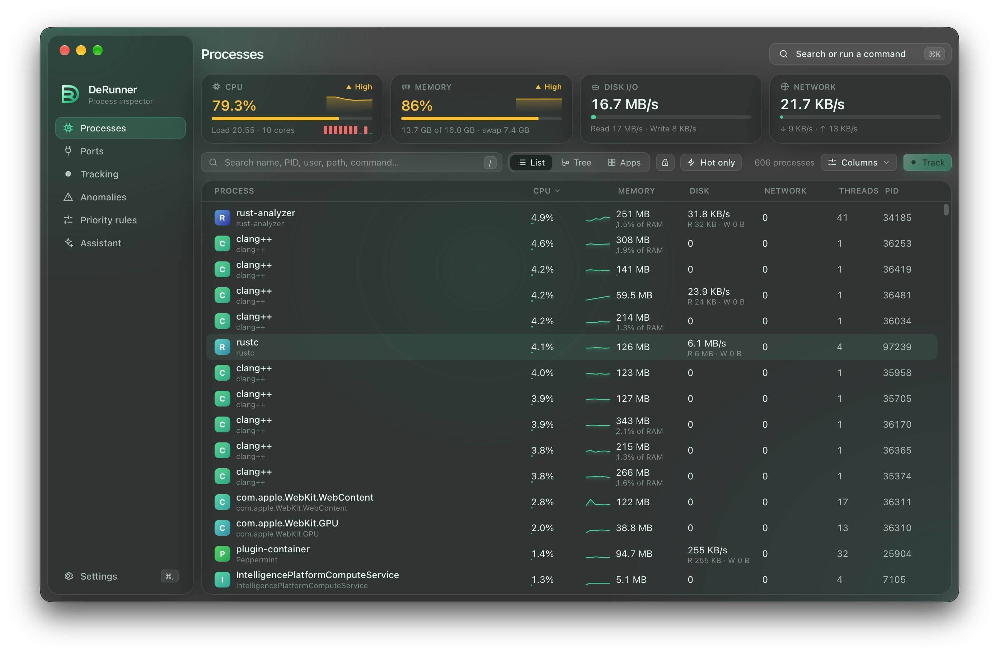

<div align="center">


# DeRunner

**See what your computer is really doing, and take back control.**

A fast, frosted-glass process manager that shows you what is eating your CPU, memory, disk and network, explains anything unusual in plain language, and lets you deal with it in one click.


</div>

---

<div align="center">

</div>

## Why DeRunner?

Your fan spins up. Your laptop gets hot. Something is slow and you have no idea what. The built-in tools show you a wall of cryptic names, and they leave the detective work to you.

DeRunner is built to answer three questions quickly:

1. **What is using my computer right now?**
2. **Is that normal, or is something wrong?**
3. **What can I safely do about it?**

It stays out of your way, sips resources when you are not looking, and sits quietly in your menu bar until you need it.

## What you can do

### Find the culprit in seconds

Every running process with live CPU, memory, disk and network use. Type to search, press `⌘K` to jump anywhere, and switch between a flat list, a **tree** (parents and their children, with totals rolled up) and an **Apps** view that groups all those mystery helper processes under the app they belong to. It stays smooth even with over a thousand processes running.

### Understand anything

Click a process to open the **Inspector**: where it lives on disk, how it was launched, what it is connected to, which files it has open, whether it is code-signed and notarized, and a live history of its CPU, memory, disk and network. Secrets in command lines are masked automatically.

### Never miss the signal

Usage is always shown with **colour, shape and a number**, so it is readable for everyone, including people with colour blindness.

| Level      | Meaning   |
| ---------- | --------- |
| Normal     | Under 70% |
| High ▲     | 70 to 90% |
| Critical ◆ | Over 90%  |

### Stay in control

Quit a process politely or force it. Take down a whole process tree. Pause an app that is hogging the machine and resume it later. Relaunch, bring a window to the front, or change priority. A **protected-process guard** keeps you from accidentally killing something your system needs.

### Get warned about odd behaviour

DeRunner watches for the things that actually matter: sustained heavy load, sudden CPU spikes, memory that keeps climbing, runaway threads, bursts of new processes, strange install locations and zombies. Every alert comes with an explanation of _why_ it was flagged. It never labels anything "malware", and you can dismiss or allowlist anything you trust.

### Record what happens

Start a **tracking session** on any process, manually or for a set time (1, 5, 10 minutes or your own). DeRunner records its behaviour in detail, including child processes starting and stopping, pauses, priority changes and anomalies, then hands you a clear report you can export as Markdown.

### Automate your priorities

Set a **priority rule** once ("always run this renderer at low priority") and DeRunner reapplies it every time the app launches. Wildcards and patterns are supported.

### See what is listening

The **Ports** view shows every open network port and exactly which app opened it.

### Ask an assistant

Want a second opinion? Ask the built-in **AI assistant** about what you are seeing. You choose the brain:

**Ollama** and **LM Studio** (fully local) · **OpenAI** · **Anthropic** · **OpenRouter**

The assistant is entirely optional.

### Lives in your menu bar

A tray icon with live CPU next to it. From there you can open the app, pause monitoring, stop tracking, check for updates, or quit. Add **launch at login** and it is always there when you need it.

### Looks the part

Frosted-glass design with light, dark and system themes. If you prefer solid surfaces or want the lowest possible GPU use, switch on **Reduce transparency**.

## Your privacy comes first

- **Everything stays on your machine** unless you turn on a cloud AI provider.
- **Your API keys live in your system keychain**, never in a plain-text file.
- **Sensitive data is redacted before it leaves your computer.** Secret-looking arguments are masked and your home folder is swapped for `~`.
- **Automatic session reports send only aggregate statistics** to cloud providers, never the raw recording.
- Want zero data leaving the machine? Use **Ollama** or **LM Studio** and everything runs locally.

## Light on your system

A process manager should not be the thing slowing you down. DeRunner:

- Pauses updates entirely when its window is hidden
- Slows down automatically when nothing needs watching, using close to 0% CPU
- Lets you choose your own refresh rate, from 0.5 s to 5 s

## Getting DeRunner

> **Status:** DeRunner is at version **0.1.0**. Public downloads are not published yet. For now you can [build it yourself](#for-developers), and release links will appear here when the first build is ready.

Once released, DeRunner checks for updates once a day (you can turn this off) and tells you when a new version is available.

### Platform support

|                               |    macOS    |    Windows    |     Linux     |
| ----------------------------- | :---------: | :-----------: | :-----------: |
| Status                        | **Primary** | Experimental  | Experimental  |
| CPU, memory, disk per process |      ✓      |       ✓       |       ✓       |
| Network per process           |      ✓      | System totals | System totals |
| Suspend, resume, priority     |      ✓      |       ✓       |       ✓       |
| Code signature check          |      ✓      |       ✓       | Package owner |

DeRunner is built and tested on macOS. Windows and Linux support is written and shares the same engine, but has not yet been tested on those systems, so expect rough edges.

## Good to know

- **Why does it need broad access?** To look inside other processes, the macOS app is not sandboxed. That is why it is distributed directly rather than through the Mac App Store.
- **Why did it say "not permitted"?** Raising a priority or touching another user's process needs elevated privileges. DeRunner tells you plainly instead of failing silently.
- **Is it safe to quit things?** Core system processes are protected, and DeRunner double-checks it is acting on the right process before it does anything.

## About

Made by **[MintFlow Technologies](https://mintflow.dev)**.
Lead developer: **Luca Montanari** ([@montanarii.luca](https://instagram.com/montanarii.luca)).

---

## For developers

Built with **Tauri v2** (Rust), **React 19**, **Tailwind 4** and **pnpm**. One Rust sampler thread feeds compact delta snapshots to a virtualized React table over a Tauri `Channel`.

```bash
pnpm install
pnpm tauri dev      # run the native app
pnpm dev            # UI only in a browser, with a mock backend
pnpm test           # frontend tests
pnpm tauri build    # release bundle
```

Rust tests: `cd src-tauri && cargo test`. Regenerate icons from `branding/logo.svg` with `pnpm icons`.

<details>
<summary>Releasing and updates</summary>

The app reads a JSON manifest (`UPDATE_MANIFEST_URL` in `src-tauri/src/update.rs`), shaped like [`derunner.json`](derunner.json):

```json
{ "latest": "0.1.0", "windows": "", "macos": "" }
```

To release: bump `version` in `package.json`, `src-tauri/Cargo.toml` and `src-tauri/tauri.conf.json`, upload the builds, then set `latest` and the per-platform download URLs in the manifest. An empty URL means the version exists but no download is published yet.

</details>

<div align="center">

<sub>Made with care by MintFlow Technologies</sub>

</div>
